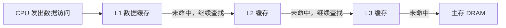

# 计算机组成原理缓存实验

## 往年参考

| 仓库                                                         | 年份        | 实验类型     | 内容与参考价值                                               |
| ------------------------------------------------------------ | ----------- | ------------ | ------------------------------------------------------------ |
| **[fu-zc23/cache-lab](https://github.com/fu-zc23/cache-lab)** | **2026 春** | **真机测量** | 四个步骤各有独立源文件，附实验报告、结果图和 Makefile；报告讨论了 WSL 与 Intel 混合核心处理器的拓扑问题。**最适合你先阅读。** |
| **[tfia/THU-CST-CA-26spring](https://github.com/tfia/THU-CST-CA-26spring)** | **2026 春** | **真机测量** | 包含测量程序、矩阵乘法、原始结果、绘图脚本和完整报告；容量测量采用随机指针追逐，适合比较不同测量方法。 |
| [KarmaD7/cache-measurement](https://github.com/KarmaD7/cache-measurement) | 2022 春     | 真机测量     | 较早的补充参考，包含测量程序、矩阵乘法、运行与绘图脚本；报告比较简略，实验环境为 Ryzen 7 5800H、Ubuntu 18.04。 |
| [Jersey-thu/Computer-Architecture-Lab](https://github.com/Jersey-thu/Computer-Architecture-Lab/tree/cachelab) | 2025        | **模拟器版** | 缓存实现位于 `cachelab` 分支，代码通过模拟器执行测试程序并统计周期。可以参考访问序列的思路，但不能直接用于你的真机测量。 |
| [zhang-tlgg/computer-architecture-labs](https://github.com/zhang-tlgg/computer-architecture-labs/tree/cache) | 2024 春     | **模拟器版** | 缓存实验位于 `cache` 分支，同样通过模拟器测量周期；作者说明完成了必做部分。 |

## 软件模拟器与硬件模拟器

模拟器的目标是在客户机中运行客户机的程序

比如：wsl是在windows系统上运行linux系统的程序，qemu是在windows上运行riscv的程序

**软件模拟器**

不直接在宿主机的cpu执行目标指令，不直接使用宿主机的cpu资源，而是使用纯软件的方式对宿主机的行为进行模拟

1. 指令执行：将目标指令动态翻译为宿主机的指令然后执行
2. 不要求指令集兼容，可以在x86指令集上运行risc的指令
3. cpu状态：使用软件的数据结构来模拟程序计数器、寄存器等
4. 缓存与存储行为：使用软件的缓存模型进行模拟


qemu等就是软件模拟器

**硬件模拟器**

让大部分指令直接在宿主机的cpu上运行，直接使用cpu的资源（pc，寄存器等），内存访问也实际经过宿主机的缓存

由cpu的虚拟化功能进行隔离和控制

1. 指令执行：大部分由宿主机的cpu直接执行
2. 直接执行部分要求指令集兼容
3. cpu状态：客户运行时使用真实 CPU 的执行资源，硬件支持保存、恢复和隔离状态
4. 缓存：普通内存访问实际经过物理 CPU 的缓存层次


wsl，Hyper-V等就是硬件模拟

## 实验总述

CPU 的缓存层次可以理解为下图：



一共有L1~L3三级缓存，CPU会由远及近的访问各层次的存储，若缓存全都没有命中，才会去访问DRAM

缓存有三个重要的参数：

| 参数                     | 含义                           | 直观理解               |
| ------------------------ | ------------------------------ | ---------------------- |
| **容量 \(C\)**           | 一共能保存多少字节的数据       | 总共能装多少           |
| **Cache line大小 \(B\)** | 缓存管理、填充数据的基本块大小 | 一次以多大的块保存数据 |
| **相联度 \(W\)**         | 每个缓存组能容纳多少条缓存行   | 同一组里有多少个位置   |

我们要做的就是测量这些参数

| 实验              | 要回答的问题                     | 主要改变什么                 | 主要观察什么                   |
| ----------------- | -------------------------------- | ---------------------------- | ------------------------------ |
| 1. 测量缓存容量   | L1 数据缓存、L2 缓存有多大？     | 实际访问的数据范围           | 平均访存时间随工作集大小的变化 |
| 2. 测量缓存行大小 | 一条缓存行有多少字节？           | 相邻访问之间的步长           | 平均访存时间随步长的变化       |
| 3. 测量相联度     | 一个缓存组能容纳几条缓存行？     | 访问地址的映射关系及数量     | 冲突增加时的时间变化           |
| 4. 优化矩阵乘法   | 怎样让访问更符合缓存的工作方式？ | 循环顺序、数据布局、分块方式 | 结果是否正确、加速比有多大     |

## 1. 读取cache参数

使用`lscpu --cache`指令读取cache参数

```shell
❯ lscpu --cache
NAME ONE-SIZE ALL-SIZE WAYS TYPE        LEVEL  SETS PHY-LINE COHERENCY-SIZE
L1d       48K     768K   12 Data            1    64        1             64
L1i       64K       1M   16 Instruction     1    64        1             64
L2         3M      48M   12 Unified         2  4096        1             64
L3        24M      24M   12 Unified         3 32768        1             64
```

进入`/sys/devices/system/cpu/cpu0/cache`文件夹，可以获取更多的cache参数

```
❯ cd index0
❯ ls
coherency_line_size  level           physical_line_partition  shared_cpu_map  type    ways_of_associativity
id                   number_of_sets  shared_cpu_list          size            uevent
❯ cat ways_of_associativity
12
❯ cat coherency_line_size
64
```

`ways_of_associativity`得到cache的相连度为12

`coherency_line_size`得到cache的相连度为64

注意L1和L2都是CPU独占的，也就是一个CPU有48k的L1d，有3M的L2

但是L3是共有的

## 2. 实验1：测试cache的大小

### 基本原理

实验通过改变**测试数组大小**和**访问步长**，测量平均每次访存的耗时，观察缓存容量对访存性能的影响。

设本轮测试的数组大小为 N，访问步长为 s。在数组范围内，每隔 s 字节选取一个访问点，再按顺序或随机顺序反复访问这些点。例如，N 为 4 KiB、s 为 64 B 时，选取的字节偏移为：

```
0、64、128、192、……、4032
```

固定一种步长，逐渐增大数组大小：

1. **数组较小时：**访问点涉及的缓存行较少，经过预热后，通常能够保留在 L1 Cache 中。后续访问主要命中 L1，平均访问时间较短。
2. **数组逐渐增大时：**访问点增多，涉及的缓存行也随之增多。当 L1 无法容纳这些缓存行时，访问过程中会发生替换，部分访问需要从 L2 获取数据，平均访问时间上升。
3. **数组进一步增大时：**当 L2 也无法容纳这些缓存行时，需要更多地从 L3，甚至主存 DRAM 获取数据，平均访问时间进一步上升。

每组参数都先进行预热，再执行相同次数的访问，并计算平均每次访问的耗时。以**数组大小为横轴、平均访问时间为纵轴**绘图；更换步长并重复测试，可以得到不同步长对应的曲线。

数组大小决定选点的范围，步长决定这个范围内选取哪些位置。**当步长等于缓存行大小、数组按缓存行对齐时，每条缓存行都有一个访问点，便可以根据曲线转折处的数组大小粗略估计缓存容量。** 其他步长的曲线用于比较访问模式的影响，分析转折位置时需要结合其选点方式。

### 注意的问题

1. 访问顺序

   如果顺序访问，那么 CPU 发现访问顺序后会进行硬件预取，可能会提前把后面的数据取来

2. 并行访存

   如果访存操作之前完全独立，那么CPU就可以进行并行访存，导致时间偏短

3. 步长的选取

   需要考虑选取的访问点和缓存行之间的关系。不妨让数组为64字节对齐（因为缓存行的大小是64），也就是从数组开头开始，每隔64就是一个新的缓存行，理论上只需要以64为步长来取点就可以了。实验中多测试一些步长用于比较

解决：

1. 对工作集中的访问点，进行随机排序，然后按照这个随机顺序进行访问
2. 构建访问之间的依赖：在访问点中存储下个访问点的地址下标，这样前后的访问之间有依赖，避免并行访存

完整的步骤是：

1. 先开数组，按照固定步长选出访问点（可以改变步长来进行测试）
2. 把这些点随机排列
3. 每个访问点里保存下一个访问点的下标，把所有点连成一个环
4. 按这个顺序反复访问


绑定CPU：因为每个cpu都有自己的L1，所以cpu调度可能带来cache缺失，所以要将程序绑定到一个cpu上执行

```cpp
    // 绑定到 Core 0
    cpu_set_t mask;
    CPU_ZERO(&mask);
    CPU_SET(0, &mask);
    if (sched_setaffinity(0, sizeof(mask), &mask) < 0) {
        perror("sched_setaffinity");
    }
```


注意透明大页的使用

在x86中，默认的虚拟内存页表的大小是4k，当测试数组很大的时候，这块内存对应的虚拟页表会被切分成很多个页面

当进行随机访问的时候，每次访问几乎都会落在不同的页表页面中，导致TLB缺失，导致访问变慢

使用2M的透明大页，就能够大大降低TLB缺失带来的影响

```cpp
    // 分配 64MB 内存，严格按 2MB (2 * 1024 * 1024) 边界对齐以激活透明大页
    const size_t BUF_BYTES = 64ULL * 1024 * 1024;
    void* raw_ptr = nullptr;
    if (posix_memalign(&raw_ptr, 2 * 1024 * 1024, BUF_BYTES) != 0) {
        perror("posix_memalign");
        return 1;
    }

    // 申请透明大页并立刻写入，强制触发 2MB 大页缺页中断
    madvise(raw_ptr, BUF_BYTES, MADV_HUGEPAGE);
    memset(raw_ptr, 0, BUF_BYTES);

    volatile int* buffer = reinterpret_cast<volatile int*>(raw_ptr);
```


## 3. 实验2：测试cacheline的大小

基本原理：

选取一个大于L1小于L2的数组

我们的L1是32k，L2是512k，所以可以选择数组大小为256k

然后使用不同步长来反复访问这个数组

随着步长逐渐扩大，能够命中缓存行的比例会逐渐减少，直到步长大于等于缓存行大小，此时每次访问都会访问到一个新的缓存行

- **步长小于缓存行大小时**，一条缓存行载入后，可以供后面几次访问使用。
- **步长达到缓存行大小时**，相邻两次访问落在不同缓存行中，无法再利用刚刚访问的那条缓存行。
- **步长继续增大时**，仍然是每次访问一条不同的缓存行，已经没有进一步减少的行内复用机会。

| 步长  | 访问的字节偏移     | 一条 64 B 缓存行内访问几次 | 理想情况下的 L1 缺失比例 |
| ----- | ------------------ | -------------------------- | ------------------------ |
| 4 B   | 0、4、8、12……      | 16 次                      | 约 1/16                  |
| 8 B   | 0、8、16、24……     | 8 次                       | 约 1/8                   |
| 16 B  | 0、16、32、48……    | 4 次                       | 约 1/4                   |
| 32 B  | 0、32、64、96……    | 2 次                       | 约 1/2                   |
| 64 B  | 0、64、128、192……  | 1 次                       | 约 1                     |
| 128 B | 0、128、256、384…… | 每隔一条缓存行访问一次     | 约 1                     |

这样只需测试不同步长下的平均访问时间，当出现明显上升的时候就是到达缓存行大小了

> [!tip]
>
> 数组容量的选择：
>
> **数组超过 L1 容量。** 循环访问时，L1 需要不断替换缓存行。如果数组很小，预热后访问的数据都留在 L1 中，就难以观察载入新缓存行的代价。
>
> **数组能够放入 L2。** 预热后，L1 缺失时主要由 L2 提供数据，使实验更集中地反映 L1 缓存行的利用情况。

问题：

1. 硬件预取带来的影响。因为是等步长访问，所以硬件可能会将后面要使用的block预取到cache中


第一次实验：顺序访问

几乎没有区别

```
stride_bytes,array_size_kib,avg_ns_per_access
4,256,1.844676
8,256,1.985767
16,256,2.018249
32,256,2.006199
64,256,1.994876
80,256,2.041634
96,256,2.092638
128,256,2.127089
256,256,2.192545

```

第二次实验：打乱顺序后再次访问，后一个访问点下标放在前一个访问点的空间中

```
stride_bytes,array_size_kib,avg_ns_per_access
4,256,1.936298
8,256,1.958997
16,256,2.041840
32,256,2.307409
48,256,2.566205
64,256,3.186152
80,256,3.182806
96,256,4.289986
128,256,4.473016
256,256,4.900388
```

可以观测到比较明显的现象，说明硬件的预取影响是非常大的

## 4. 实验3：测试 Cache 相连度

核心思路：让多个地址竞争同一个缓存组。固定一个能映射到同一缓存组的步长，再逐渐增加访问点数，通过组内放不下时的延迟上升测量相联度

原理：

$ \text{缓存行编号}=\left\lfloor\frac{\text{地址}}{\text{缓存行大小}}\right\rfloor$

$ \text{组号}=\text{缓存行编号}\bmod\text{组数} $

设总共有 X 条缓存行，相联度为 W，缓存行大小为 B，那么组数为 X/W。两个地址相差：

$ \frac{X}{W}\times B $

的整数倍，就会映射到同一个组。

而 L1 cache 本身的大小一定是$ \frac{X}{W}\times B $的整数倍，那么我们不妨就使用 L1 Cache 的大小作为步长进行访问：

```
第 1 个点：偏移   0 KiB
第 2 个点：偏移  32 KiB
第 3 个点：偏移  64 KiB
第 4 个点：偏移  96 KiB
……
```

每次选择前面k个节点，进行环形访问，这k个节点都会映射到同一个缓存组

当k不大于相连度的时候，缓存组能够完全装下访问点所在的数据块，每次都能命中缓存

当k大于相连度的时候，组中无法容纳所有的数据块，会出现 Cache miss，导致访问延迟明显增加

所以，理想情况下：

$\boxed{\text{相联度}=\text{首次明显变慢的访问点数}-1}$

```
point_count,stride_bytes,avg_ns_per_access
1,32768,1.848604
2,32768,1.843132
3,32768,1.849658
4,32768,1.849202
5,32768,1.842517
6,32768,1.845009
7,32768,1.843183
8,32768,1.856107
9,32768,4.782160
10,32768,4.921968
11,32768,4.909938
12,32768,4.918647
13,32768,4.919221
14,32768,4.922925
15,32768,4.915379
16,32768,4.917962
```

相当明显，9出现了突然上升，说明相连度是8

## 5. 实验4：矩阵乘法优化

原本的矩阵乘法代码：

```cpp
//======================================================
    for (i = 0; i < MATRIX_SIZE; i ++)
        for (j = 0; j < MATRIX_SIZE; j ++)
            for (k = 0; k < MATRIX_SIZE; k ++)
                d[i][j] += a[i][k] * b[k][j];
    // Stop here.
    //======================================================
```

最核心的问题是访存的顺序，在最内层循环：

- d：不变
- a：同一行访问
- b：同一列访问

对于b的访问地址变化很大，导致无法利用缓存的局部性

最直接的优化就是修改遍历的顺序：

```cpp
// 按 i → k → j 的顺序计算。
// 最内层连续访问 B 和 D 的一行，提高缓存行的利用率。
for (i = 0; i < MATRIX_SIZE; ++i) {
    // 当前需要更新的结果行。
    int* d_row = d[i];

    for (k = 0; k < MATRIX_SIZE; ++k) {
        // 最内层循环中保持不变的 A 元素。
        int a_ik = a[i][k];

        // 当前连续读取的 B 行。
        int* b_row = b[k];

        for (j = 0; j < MATRIX_SIZE; ++j) {
            d_row[j] += a_ik * b_row[j];
        }
    }
}
```

先遍历k，再遍历j，对于最内层循环：

| 数据      | 最内层循环中的行为           |
| --------- | ---------------------------- |
| `a[i][k]` | 固定不变，同一个值被重复使用 |
| `b[k][j]` | 沿着 B 的第 k 行连续读取     |
| `d[i][j]` | 沿着 D 的第 i 行连续更新     |


进一步优化：使用分块算法

目前的访问方式一次会直接访问一个矩阵的一整行，cache 无法将所有数据都装下，会出现缓存缺失

考虑将整个矩阵划分成多个小块，每次只计算一个小块，从而将数据放入 cache 中，提高效率

矩阵乘法公式：

$D[i][j]=\sum_k A[i][k]B[k][j] $

将矩阵划分为 $32 \times 32$的小块

例如要计算D的第一个小块：D 的第 0～31 行、第 0～31 列

| `kk` | 使用的 A 子块                | 使用的 B 子块                | 结果            |
| ---- | ---------------------------- | ---------------------------- | --------------- |
| 0    | 第 0～31 行，第 0～31 列     | 第 0～31 行，第 0～31 列     | 累加到当前 D 块 |
| 32   | 第 0～31 行，第 32～63 列    | 第 32～63 行，第 0～31 列    | 累加到当前 D 块 |
| 64   | 第 0～31 行，第 64～95 列    | 第 64～95 行，第 0～31 列    | 累加到当前 D 块 |
| ……   | ……                           | ……                           | ……              |
| 992  | 第 0～31 行，第 992～1023 列 | 第 992～1023 行，第 0～31 列 | 累加到当前 D 块 |


```cpp
const int block_size = 32;

// ii、jj 确定当前计算的 D 子块。
// kk 沿乘法的求和方向移动，将各对子块的乘积累加到 D 子块中。
for (int ii = 0; ii < MATRIX_SIZE; ii += block_size) {
    for (int jj = 0; jj < MATRIX_SIZE; jj += block_size) {
        for (int kk = 0; kk < MATRIX_SIZE; kk += block_size) {

            // 计算当前子块，块内使用 i → k → j 的循环顺序。
            for (i = ii; i < ii + block_size; ++i) {
                int* d_row = d[i];

                for (k = kk; k < kk + block_size; ++k) {
                    // 固定 A 的一个元素，连续读取 B 并更新 D。
                    int a_ik = a[i][k];
                    int* b_row = b[k];

                    for (j = jj; j < jj + block_size; ++j) {
                        d_row[j] += a_ik * b_row[j];
                    }
                }
            }
        }
    }
}
```

