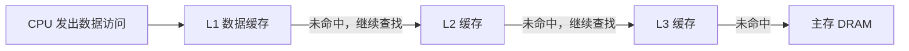

# 计算机组成原理缓存实验

## 往年参考

| 仓库                                                         | 年份        | 实验类型     | 内容与参考价值                                               |
| ------------------------------------------------------------ | ----------- | ------------ | ------------------------------------------------------------ |
| **[fu-zc23/cache-lab](https://github.com/fu-zc23/cache-lab)** | **2026 春** | **真机测量** | 四个步骤各有独立源文件，附实验报告、结果图和 Makefile；报告讨论了 WSL 与 Intel 混合核心处理器的拓扑问题。**最适合你先阅读。** |
| **[tfia/THU-CST-CA-26spring](https://github.com/tfia/THU-CST-CA-26spring)** | **2026 春** | **真机测量** | 包含测量程序、矩阵乘法、原始结果、绘图脚本和完整报告；容量测量采用随机指针追逐，适合比较不同测量方法。 |
| [KarmaD7/cache-measurement](https://github.com/KarmaD7/cache-measurement) | 2022 春     | 真机测量     | 较早的补充参考，包含测量程序、矩阵乘法、运行与绘图脚本；报告比较简略，实验环境为 Ryzen 7 5800H、Ubuntu 18.04。 |
| [Jersey-thu/Computer-Architecture-Lab](https://github.com/Jersey-thu/Computer-Architecture-Lab/tree/cachelab) | 2025        | **模拟器版** | 缓存实现位于 `cachelab` 分支，代码通过模拟器执行测试程序并统计周期。可以参考访问序列的思路，但不能直接用于你的真机测量。 |
| [zhang-tlgg/computer-architecture-labs](https://github.com/zhang-tlgg/computer-architecture-labs/tree/cache) | 2024 春     | **模拟器版** | 缓存实验位于 `cache` 分支，同样通过模拟器测量周期；作者说明完成了必做部分。 |

## 软件模拟器与硬件模拟器

模拟器的目标是在客户机中运行客户机的程序

比如：wsl是在windows系统上运行linux系统的程序，qemu是在windows上运行riscv的程序

**软件模拟器**

不直接在宿主机的cpu执行目标指令，不直接使用宿主机的cpu资源，而是使用纯软件的方式对宿主机的行为进行模拟

1. 指令执行：将目标指令动态翻译为宿主机的指令然后执行
2. 不要求指令集兼容，可以在x86指令集上运行risc的指令
3. cpu状态：使用软件的数据结构来模拟程序计数器、寄存器等
4. 缓存与存储行为：使用软件的缓存模型进行模拟

qemu等就是软件模拟器

**硬件模拟器**

让大部分指令直接在宿主机的cpu上运行，直接使用cpu的资源（pc，寄存器等），内存访问也实际经过宿主机的缓存

由cpu的虚拟化功能进行隔离和控制

1. 指令执行：大部分由宿主机的cpu直接执行
2. 直接执行部分要求指令集兼容
3. cpu状态：客户运行时使用真实 CPU 的执行资源，硬件支持保存、恢复和隔离状态
4. 缓存：普通内存访问实际经过物理 CPU 的缓存层次

wsl，Hyper-V等就是硬件模拟

## 实验总述

CPU 的缓存层次可以理解为下图：

一共有L1~L3三级缓存，CPU会由远及近的访问各层次的存储，若缓存全都没有命中，才会去访问DRAM

缓存有三个重要的参数：

| 参数                     | 含义                           | 直观理解               |
| ------------------------ | ------------------------------ | ---------------------- |
| **容量 \(C\)**           | 一共能保存多少字节的数据       | 总共能装多少           |
| **Cache line大小 \(B\)** | 缓存管理、填充数据的基本块大小 | 一次以多大的块保存数据 |
| **相联度 \(W\)**         | 每个缓存组能容纳多少条缓存行   | 同一组里有多少个位置   |

我们要做的就是测量这些参数

| 实验              | 要回答的问题                     | 主要改变什么                 | 主要观察什么                   |
| ----------------- | -------------------------------- | ---------------------------- | ------------------------------ |
| 1. 测量缓存容量   | L1 数据缓存、L2 缓存有多大？     | 实际访问的数据范围           | 平均访存时间随工作集大小的变化 |
| 2. 测量缓存行大小 | 一条缓存行有多少字节？           | 相邻访问之间的步长           | 平均访存时间随步长的变化       |
| 3. 测量相联度     | 一个缓存组能容纳几条缓存行？     | 访问地址的映射关系及数量     | 冲突增加时的时间变化           |
| 4. 优化矩阵乘法   | 怎样让访问更符合缓存的工作方式？ | 循环顺序、数据布局、分块方式 | 结果是否正确、加速比有多大     |