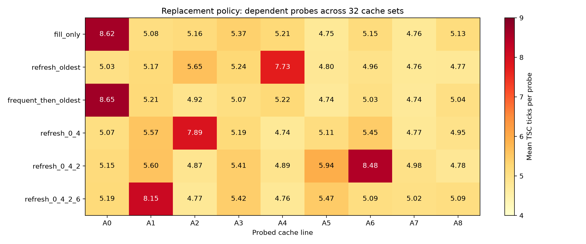
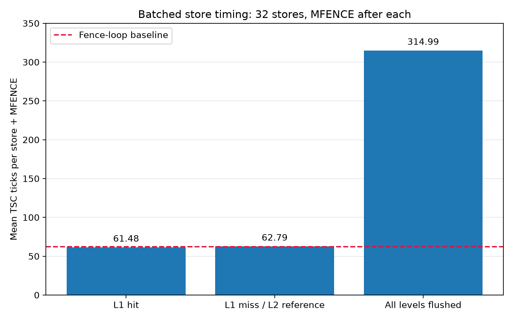
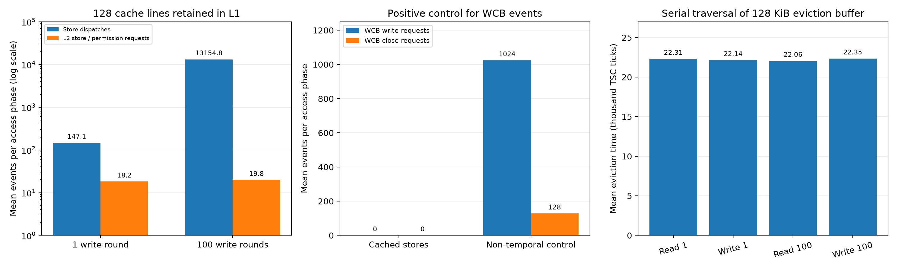

# 缓存实验

## Cache 参数

```shell
lscpu --cache
NAME ONE-SIZE ALL-SIZE WAYS TYPE        LEVEL  SETS PHY-LINE COHERENCY-SIZE
L1d       32K     128K    8 Data            1    64        1             64
L1i       32K     128K    8 Instruction     1    64        1             64
L2       512K       2M    8 Unified         2  1024        1             64
L3        16M      16M   16 Unified         3 16384        1             64
```

缓存相连度为8，cache line 大小为64B

## 实验一：测量 L1 DCache 和 L2 Cache 的大小

### 访存序列

设取点的数组范围为m字节，步长为l字节。首先在该范围内选取字节偏移为 $0,l,2l,\ldots$ 的位置，然后随机打乱这些位置，将其连接成一个环。每个位置保存下一个位置的数组下标，最后一个位置指向第一个位置。

测量时反复执行 `index = buffer[index]`。由于下一次访问的位置依赖于当前读取的结果，访问顺序不再是固定间隔的顺序扫描，可以减弱规律性硬件预取的影响，并限制多次读取之间的并行执行。

本实验测试的步长为：
$l\in{32,64,128,256,512}\ \text{B}$

数组范围从 4 KiB 增加到 8192 KiB，并在缓存容量附近设置较密集的采样点。其中，L2 附近的测试点包括 256、384、448、512、768 和 1024 KiB。

### 实验结果与分析

实验结果如下图所示。横轴为取点的数组范围，单位为 KiB；纵轴为每次访问的平均耗时，单位为 ns；不同曲线对应不同步长。


由图可以发现，当array size增加，大小超出 Cache 的大小的时候，由于 Cache Miss，出现了比较明显的访问延迟增加。其中有两个比较明显的台阶

当数组范围不超过 32 KiB 时，平均访问时间基本保持在 2.15 ns 左右。增大到 48 KiB 后，访问时间上升到约 5.2 ns，形成第一个明显的台阶。这说明数组范围超过 L1 DCache 容量后，部分访问需要由 L2 Cache 满足。容量转折与 32 KiB 的 L1 DCache 规格相符。

数组范围从 48 KiB 增加到 448 KiB 时，平均访问时间基本维持在 5.2 ns 左右。增大到 512 KiB 时，访问时间已经上升到约 8.4 ns；随后在 768 和 1024 KiB 处继续上升。这表明在接近 512 KiB 时，L2 Cache 已经难以继续维持较高的命中率。此处转折点相比于 L2 Cache 容量偏小

### 思考题

> 为什么 L1 DCache 的测量结果与规格相符，而 L2 Cache 可能表现出容量偏小？

本次实验出现了与题目示例相似的现象：L1 DCache 在 32 KiB 的采样点仍保持较低延迟，到了下一个采样点 48 KiB 才明显上升；而 L2 Cache 在 512 KiB 的采样点就已经出现明显的延迟上升。测量的结果比实际的 L2 Cache 容量偏小

一个合理的解释是，L1 DCache 专门缓存数据，程序指令由独立的 L1 ICache 缓存；而 L2 Cache 是指令和数据统一缓存，测试数组的数据会与程序指令及其他数据竞争缓存空间。因此，L2 的标称容量不一定能全部用于容纳测试数组，即使数组范围尚未超过标称容量，也可能出现额外的缓存缺失，使测量结果表现为略微偏小。

## 实验2：测量 cache line 的大小

### 访存序列

数组范围为 256 KiB，大于 L1 DCache 的 32 KiB，小于 L2 Cache 的 512 KiB，步长为 l 字节。将数组划分为 1024 个 256 B 的块，随机打乱块的访问顺序。在每个块内部选取字节偏移为 $0,l,2l,\ldots$ 且小于 256 B 的位置，按偏移从小到大的顺序访问。

每个访问点保存下一个位置的数组下标，块内最后一个点指向下一个随机块的首点，最后一个块连接回第一个块，形成访问环。测量时反复执行 `index = buffer[index]`，使后一次读取依赖于前一次读取的结果，限制读取的并行执行。块间随机访问可以减弱规律性硬件预取的影响，块内顺序访问则保留了小步长下同一缓存行的复用。

### 实验结果与分析


通过读取系统文件可以知道该处理器的 cache line 大小为 64 B。

由图可以看到，小步长下平均访问时间较低，步长从 4 B 增加到 32 B 时，平均访问时间从约 1.94 ns 增加到 2.21 ns；增大到 48 B 和 64 B 时，平均访问时间分别为约 2.52 ns 和 3.19 ns。小步长下，同一缓存行可以供多次访问使用；步长达到 64 B 时，块内相邻访问点落在不同缓存行上，平均访问时间明显增加，与已知缓存行大小为 64 B 的情况相符。

### 思考题

> Prefetch 对于该实验的结果有影响吗？给出你的分析和结论。

Prefetch 对于该实验有着较大的影响。为了进行对比，我进行了两次实验：

**第一次实验**：顺序访问

```
stride_bytes,array_size_kib,avg_ns_per_access
4,256,1.844676
8,256,1.985767
16,256,2.018249
32,256,2.006199
64,256,1.994876
80,256,2.041634
96,256,2.092638
128,256,2.127089
256,256,2.192545

```

各步长的平均访问时间集中在约 1.84～2.19 ns，差别较小，没有观察到明显的转折。

**第二次实验**：块间随机、块内按步长顺序访问，每个访问点保存下一个访问点的下标，形成访问依赖。

```
stride_bytes,array_size_kib,avg_ns_per_access
4,256,1.936298
8,256,1.958997
16,256,2.041840
32,256,2.207409
48,256,2.516205
64,256,3.186152
96,256,4.289986
128,256,4.473016
256,256,4.900388
```

平均访问时间随步长增大，从约 1.94 ns 增加到 4.90 ns，不同步长之间的差异更加明显。

分析：当使用顺序访问进行实验的时候，由于步长固定、地址变化规律，处理器可以识别访问模式，提前将相关缓存行取入缓存，从而掩盖部分缓存缺失的等待时间，使改变步长对于平均访问时间的影响不明显。

当改用块间随机、块内顺序访问时，跨块访问的可预测性降低，规律性预取的效果减弱，而块内仍保留同一缓存行的复用，因此不同步长之间的访问时间差异更明显。这组对比说明，Prefetch 会影响通过访问时间测量缓存行大小的结果，设计访存序列时需要减弱规律性预取的影响。

## 实验3：测量 Cache 相连度

### 访存序列与算法分析

本实验测量 L1 DCache 的相联度，采用固定访问步长、逐渐增加访问点数的方法，使多个访问点对应的缓存行竞争同一个缓存组。

设 Cache 容量为 $C$，缓存行大小为 $B$，相联度为 $W$，则缓存组数为：

$$
S=\frac{C}{B\times W}
$$

两个地址相差 $S\times B$ 的整数倍时，会映射到同一个缓存组。由于：

$$
C=W\times S\times B
$$

因此，可以直接使用 Cache 的总容量作为访问步长，使所有访问点映射到同一个组。

本机 L1 DCache 容量为 32 KiB，因此固定步长为 32 KiB，分配一个 512 KiB 的数组，访问点数 $k$ 从 1 逐个增加到 16。每次实验选取的字节偏移为：

$$
0,\ 32\text{ KiB},\ 64\text{ KiB},\ \ldots,\ (k-1)\times32\text{ KiB}
$$

选取访问点后，随机打乱它们的顺序，并连接成一个环。每个位置保存下一个位置的数组下标，最后一个位置指向第一个位置。随机排列只改变访问顺序，所有访问点仍映射到同一个缓存组。

测量时反复执行 `index = buffer[index]`。由于后一次访问依赖于前一次读取的结果，可以限制读取的并行执行；随机访问顺序则可以减弱规律性硬件预取的影响。

当访问点数较小时，同一个组能够容纳这些缓存行，预热后大多数访问命中 L1 DCache。当访问点数超过相联度时，这些缓存行会在同一个组中相互替换，产生冲突缺失，使平均访问时间上升。通过观察访问时间上升的点数就可以判断相连度

### 测量结果与分析

```
point_count,stride_bytes,avg_ns_per_access
1,32768,1.848604
2,32768,1.843132
3,32768,1.849658
4,32768,1.849202
5,32768,1.842517
6,32768,1.845009
7,32768,1.843183
8,32768,1.856107
9,32768,4.782160
10,32768,4.921968
11,32768,4.909938
12,32768,4.918647
13,32768,4.919221
14,32768,4.922925
15,32768,4.915379
16,32768,4.917962
```


由图可以看到，当访问点数从 1 增加到 8 时，平均访问时间基本保持在 1.85 ns 左右，没有明显增长。这说明这些访问点对应的缓存行可以同时保留在同一个 L1 缓存组中，经过预热后，访问基本命中 L1 DCache。

当访问点数从 8 增加到 9 时，平均访问时间由约 1.86 ns 上升到 4.78 ns，形成明显的台阶。这说明第 9 条缓存行加入后，已经超过该组能够同时容纳的缓存行数量。反复访问这些点会引起组内替换，产生 L1 冲突缺失，部分访问需要由 L2 Cache 满足，从而增加平均访问时间。

测量结果与系统报告的 L1 DCache 为 **8 路组相联**一致。

## 实验4：优化矩阵乘法

我修改的代码：

```cpp
    const int block_size = 32;

    // ii、jj 确定当前计算的 D 子块。
    // kk 沿乘法的求和方向移动，将各对子块的乘积累加到 D 子块中。
    for (int ii = 0; ii < MATRIX_SIZE; ii += block_size) {
        for (int jj = 0; jj < MATRIX_SIZE; jj += block_size) {
            for (int kk = 0; kk < MATRIX_SIZE; kk += block_size) {

                // 计算当前子块，块内使用 i → k → j 的循环顺序。
                for (i = ii; i < ii + block_size; ++i) {
                    int* d_row = d[i];

                    for (k = kk; k < kk + block_size; ++k) {
                        // 固定 A 的一个元素，连续读取 B 并更新 D。
                        int a_ik = a[i][k];
                        int* b_row = b[k];

                        for (j = jj; j < jj + block_size; ++j) {
                            d_row[j] += a_ik * b_row[j];
                        }
                    }
                }
            }
        }
    }
```

主要使用了两种优化：

1. 矩阵分块，使得每次访问的数据尽量都能留在缓存中
2. 改变遍历顺序，使用使用 i → k → j 的循环顺序，利用局部性

最终测试结果：

```
❯ ./build/matrix_mul
time spent for original method : 4.86591 s
time spent for new method : 1.17545 s
time ratio of performance optimization : 4.13962
```

## 实验5（选做）：测量 Cache 的替换策略和写策略

L1 DCache 参数：容量为 32 KiB，缓存行大小为 64 B，相联度为 8，L2 容量为 512 KiB。

### 一、替换策略

#### 访存序列与理论分析

每隔 32 KiB 选择一个访问点，将选出的九个点随机编号为 A0～A8。这些点对应的缓存行映射到同一个 L1 缓存组，随机编号使逻辑访问顺序不对应固定步长的扫描

先依次访问 A0～A7，填满该组，再改变部分点的访问次数和顺序，最后读入 A8，触发替换。首先构造三种序列：

1. **fill_only**：依次访问 A0～A7，再访问 A8
2. **refresh_oldest**：依次访问 A0～A7，再访问一次 A0，最后访问 A8
3. **frequent_then_oldest**：依次访问 A0～A7，再访问 A0 共 16 次，随后依次访问 A1～A7，最后访问 A8

LRU 淘汰最久未使用的行，FIFO 淘汰最早进入的行，LFU 淘汰访问次数最少的行

另外构造三种序列，用于检验 Tree-PLRU 的树形更新规律：

4. **refresh_0_4**：依次访问 A0～A7，再访问 A0、A4，最后访问 A8
5. **refresh_0_4_2**：依次访问 A0～A7，再访问 A0、A4、A2，最后访问 A8
6. **refresh_0_4_2_6**：依次访问 A0～A7，再访问 A0、A4、A2、A6，最后访问 A8

按 A0～A7 对应叶结点顺序构造模型，依次访问 A0～A7 后，候选淘汰对象是 A0；再访问 A0，根结点的淘汰方向转向另一半，候选对象变为 A4；继续访问 A4、A2、A6，候选对象依次变为 A2、A6、A1。六种序列的理论预测见后面的对照表

#### 测量方法

在32 个不同缓存组中构造相同访问历史，再一次串行探测这 32 个组，累加命中与缺失的时间差。

同一组内仍使用 32 KiB 的地址间隔，不同组的基地址相隔 128 B。将不同组中的同一候选点连接成指针环，例如将各组的 A0 连接起来，打乱组间访问顺序

按照以上6种访存序列进行访问，测出每个访问点的平均耗时，耗时明显偏高的对应的就是按照替换策略被替换出去的缓存行，根据被替换出去的缓存行就可以验证采用的缓存替代策略

#### 测量结果与分析

校准结果如下：

| 校准状态 | 平均每次探测耗时 / tick | 中位数 / tick |
|---|---:|---:|
| L1 命中参考 | 4.730 | 4.406 |
| L1 缺失、L2 命中参考 | 7.341 | 7.344 |

两种参考状态形成了明显差异，可以通过比较各候选点的探测耗时，识别被替换的缓存行。



每条序列均出现了一个明显较慢的候选点，其他点的平均耗时约为 4.7～5.9 tick。将该点与各模型的预测对照：

| 访问序列 | LRU 预测 | FIFO 预测 | LFU 预测 | Tree-PLRU 预测 | 实测明显变慢的点 | 该点平均耗时 / tick |
|---|---|---|---|---|---|---:|
| fill_only | A0 | A0 | A0 | A0 | A0 | 8.621 |
| refresh_oldest | A1 | A0 | A1 | A4 | A4 | 7.728 |
| frequent_then_oldest | A0 | A0 | A1 | A0 | A0 | 8.654 |
| refresh_0_4 | A1 | A0 | A1 | A2 | A2 | 7.893 |
| refresh_0_4_2 | A1 | A0 | A1 | A6 | A6 | 8.479 |
| refresh_0_4_2_6 | A1 | A0 | A1 | A1 | A1 | 8.148 |

其中，refresh_oldest 的区分最直接：A0、A1 的平均耗时分别为 5.025、5.173 tick，A4 上升到 7.728 tick。说明重新访问 A0 后，替换对象转到了 A4，与严格 LRU、FIFO 和上述 LFU 模型的预测均不同

随后三条序列观察到的替换对象依次为 A2、A6、A1，与树形方向位逐层更新的预测相符。第三条基础序列中，A0 虽然被额外访问了 16 次，但在后续访问 A1～A7 后仍成为替换对象，也说明访问次数多并不会像上述 LFU 模型那样持续保护它

因此，六条鉴别序列的结果均与 Tree-PLRU 一致，实验支持该处理器的 L1 DCache 使用树形伪 LRU 替换策略，并排除了这里比较的严格 LRU、FIFO 和 LFU 模型

### 二、写策略

#### 访存序列与理论分析

分别构造以下三种状态：

1. **L1 写命中**：先读取目标缓存行，使其进入 L1，再计时写入
2. **L1 写缺失、L2 命中参考**：先读取目标行，再扫描 128 KiB 的缓冲区将其从 L1 驱逐，随后计时写入
3. **冷写入**：使用 CLFLUSH 清除各级缓存中的目标行，等待完成后再计时写入

使用 32 条属于不同缓存组的目标行，打乱访问顺序。每次计时连续写入这 32 条缓存行，每次写入后执行 MFENCE，将等待写入全局可见的时间纳入测量，减弱 store buffer 对耗时的掩盖。整批只读取两次时间戳，再将总时间除以 32。另测只执行循环和屏障的基线

Write-through 在写命中时也向下一级传递修改；Write-back 可以将修改保留在当前缓存的脏行中，之后在替换等情况下向下一级写回。MFENCE 保证此前写入全局可见，但不会强制将脏缓存行写回下一级

#### 测量结果与分析

测量结果如下，耗时包含每次写入后的 MFENCE 开销：



| 测量情况 | 平均每次操作耗时 / tick | 中位数 / tick |
|---|---:|---:|
| 循环与屏障基线 | 62.310 | 61.688 |
| L1 写命中 | 61.478 | 60.969 |
| L1 写缺失、L2 命中参考 | 62.788 | 62.438 |
| 清除各级缓存后的冷写入 | 314.994 | 318.359 |

冷写入的耗时约为 L1 写命中的 5.12 倍，说明目标行不在缓存中时，获取缓存行及写入权限的开销明显增加。L1 写命中和 L2 命中参考的差距较小，测得时间主要被屏障开销占据

**MFENCE 不能完全消除各类 Buffer 的影响，这部分结果难以区分两种策略，因此我使用了另一种思路**

#### 分阶段写入与淘汰对照

##### 实验原理

通过观测数组写入次数和L2写入次数来区分写回和写直达

- 写直达：每次写入都需要向下一次存储传播，那么写入数组的次数增加，写入L2的次数应该也随之增加
- 写回：允许多次修改后再写回，那么写入数组次数增加，写入L2的次数增加应该不明显

##### 结果分析

使用 8 KiB 数组，共 128 条缓存行，提前加载到 L1。比较写入 1 轮和 100 轮的情况，并设置只读对照；每轮结束后执行 MFENCE，通过硬件计数器记录 L2 写入或权限请求。随后访问 128 KiB 缓冲区，测量目标数据被淘汰时的耗时。每组测量 200 次，取平均值



| 操作 | 目标数组写入次数 | 平均 L2 写入或权限请求数 |
|---|---:|---:|
| 写入 1 轮 | 128 | 18.160 |
| 写入 100 轮 | 12800 | 19.765 |

写入次数增加了 100 倍，L2 写入或权限请求仍约为 18～20 次，与 Write-back 将修改保留在缓存中、允许同一缓存行被多次更新的行为相符

**因此，判断使用的是 write back 策略**

我查询了官方手册，该CPU确实是采用写回策略的，和实验结果一致


## 意见和建议

建议课程组提供服务器进行实验。我最初在本机上进行实验，按照文档中的方法进行了缓存大小的测量，几乎没有观测到文档中描述的现象，访问延迟在波动中缓步上升。后面租用了服务器进行实验才观测到比较明显的结果
